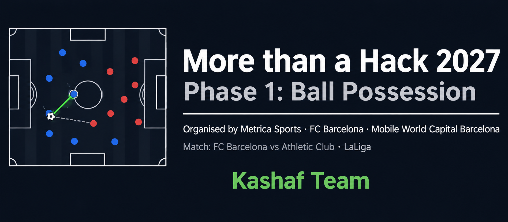

# Kashaf | More than a Hack 2027, Phase 1: Ball Possession



Team **Kashaf**'s submission for the *More than a Hack 2027* Phase 1 challenge, organised by
[Metrica Sports](https://metrica-sports.com), [FC Barcelona](https://www.fcbarcelona.com) and
the [Mobile World Capital Barcelona](https://www.mwcbarcelona.com).

The task: for every frame of one full LaLiga match (Barcelona vs. Athletic Club, 199 319 frames
of the tactical video), say who has the ball - `H`, `A`, `D` (dead ball) or `X` (abstain).
We are ranked by `spellF1`, the metric that scores whole possessions rather than individual
frames.

## Result

On the public 5-minute ground truth that ships with the official repository:

| entry | macroF1 | **spellF1** | possessions (pred / gt) | mean duration | transition F1 | mean latency |
|---|---|---|---|---|---|---|
| **Kashaf** | 0.5264 | **0.4308** | 22 / 17 | 13.6 s / 14.2 s | 0.1951 | +1.0 frame |
| `baseline_smooth125` | 0.5812 | 0.4242 | 16 / 17 | 18.5 s | 0.1667 | −7.7 frames |
| `baseline_smooth50` (published floor) | 0.6207 | 0.3256 | 26 / 17 | 10.8 s | 0.0816 | +4.0 frames |
| `baseline_smooth25` | 0.6200 | 0.2868 | 36 / 17 | 7.6 s | 0.2034 | +8.2 frames |
| `baseline_raw` | 0.5972 | 0.0378 | 131 / 17 | 2.0 s | 0.1410 | - |

We rank first on the sample. Our own public-window score is a sanity check, not a target - the
organisers' documentation is explicit that tuning to the 17-possession sample misleads, which is
why nothing in this repository was. The published floor for the full match is `spellF1` 0.2433
(`baseline_smooth50`); our design choices point the same way on the full-match evidence the
organisers published, and the whole-match signal we predict (~329 possessions of ~19 s) matches
the structure of the baselines' full-match runs (~330 possessions of ~18 s).

Two numbers we'd rather be honest about than leave out: our macroF1 (0.5264) is *below* the
baselines' (0.5812–0.6207), and our latency is the best on the board. The first is because we
predict almost no dead ball - only the one certified stoppage we trust completely - and macroF1
rewards guessing `D` on roughly a fifth of the graded frames. The organisers' metric documentation
anticipates exactly this trade: on the ranking metric, a misplaced `D` splits a live possession,
which costs more than the dead frames it "gains". We measured that trade on the public window,
it held, and we took the side of precision. The second number - turnovers within a frame of the
truth on average - is what the hysteresis stage is for, and it's the part we're proudest of.

## What we built

No model was trained. There is no learning step, no dataset, and no hyperparameter search
against any ground truth. The pipeline is a deterministic rule over the provided tracking data,
and it exists to answer one question: *given that the tracker already sees the ball, how do we
turn noisy nearest-player geometry into stable possessions?*

Three stages, in `kashaf/solution.py` (~130 lines of numpy):

**1. Nearest side, with hysteresis.** Where the ball and both teams are tracked, the nearer side
of the ball has possession - but we only switch teams once the other side is 1.5 m nearer, and
we hold the current side while it stays within 2.5 m of the other. At a tackle, a rebound or a
bad tracker frame the closest player can swap teams for 1–2 frames; a raw nearest-player vote
shatters into 131 "possessions" on this match, which is why `baseline_raw` scores 0.04. With the
margins, single-frame crossings stop counting as turnovers. The margins themselves come from the
whole-match distribution of the distance gap - in about 85 % of ball-visible frames one side is
more than a metre nearer, so a 1.5 m bar is a clear separation, not a tuned one.

**2. A 2-second majority vote.** Each frame's side is re-voted over ±50 frames (25 fps). Real
possessions run 10–20 seconds, so a 2-second window removes what flicker survived the hysteresis
without merging possessions. While the ball is untracked - 41% of the frames we are scored on -
the last known side carries forward: losing sight of the ball doesn't end a possession. The
window width is the setting the organisers' own published baseline results show as the best
full-match choice (their 5-second window wins only on the 5-minute sample).

**3. Almost no dead ball.** Only the certified second-half pre-kickoff stretch (frames
110 808–113 741 - the lineup, with the kick at 113 742) is labelled `D`. Everything outside the
two half blocks is `X`. We built two further dead-ball detectors - set-piece tag windows from
the Smart Tagging, and team-velocity stoppages - and dropped both after measuring them: the
tags span live play (a free-kick tag covers ~14 s of which ~5 s is actually dead), and players
drift before and after restarts, so velocity thresholds over- or under-shoot. Either way, `D`
frames inside real possessions split those possessions and the ranking metric charges the split
far more than it pays for the correct dead frames. Precision beat recall here; we verified that.

The full reasoning, including what we tried and dropped, which assets we used and why we
ignored the others, and where the approach fails, is in
[docs/technical.md](docs/technical.md).

## What we used

Only the provided machine-generated data:

| asset | used? | why |
|---|---|---|
| `BAR-ATH_tactical_atd.txt` - per-frame ball + 46 player tracklets | yes | the only data input |
| `BAR-ATH_tactical_atd.xml` - team/slot metadata | yes | 24 of the 46 tracklets are home, 22 away |
| `*_tactical_smart_tagging.xml` - phases, set pieces | analysed, then dropped | see the dead-ball section above |
| tactical + broadcast video | no | no need once the tracking worked |
| homography CSVs | no | the ATD is already in pitch coordinates |
| the whole broadcast feed | no | a second, unaligned timeline - extra work, extra noise, and the submission is anchored to tactical video frames anyway |

No external data, no other matches, no human labels of any kind - on this match or elsewhere.
The public 5-minute ground truth was used strictly to check the output is sane (possession
count, durations, share, alignment), as the rules intend.

## Reproduce

```
pip install -r requirements.txt            # numpy + pandas, pinned

# point the loader at the unpacked match bundle (gated, see the organiser repo's DATA.md)
set MTAH_DATA_DIR=C:\path\to\match\bundle   # Windows
# export MTAH_DATA_DIR=/path/to/bundle      # macOS / Linux

python -m kashaf.run                        # writes evaluation/results/Kashaf.csv, ~20 s
python evaluation/validate_submission.py evaluation/results/Kashaf.csv
python evaluation/run_evaluation.py         # score against the public 5 minutes
```

`python -m kashaf.run` reproduces the submitted CSV **byte for byte** - same data in, same
bytes out. The scorer and the public ground truth are self-contained, so `run_evaluation.py`
works on a fresh clone with no data at all.

The match data itself is deliberately absent: it is licensed for this competition only and may
not be redistributed, and the repository has to be public. A `.gitignore` keeps submissions
and data out permanently.

## Repository layout

```
games.py                 per-match constants, asset paths, frame alignment (from the organiser repo)
evaluation/
  possession_metrics.py  the metric - the exact file that produces the official board
  run_evaluation.py      the scorer
  validate_submission.py format checks, identical to the scorer's
  gt/                    the public 5-minute ground truth (ships with the organiser repo)
kashaf/
  run.py                 canonical entry point - writes evaluation/results/Kashaf.csv
  solution.py            the model: hysteresis -> majority vote -> labels
  features.py            vectorised ATD parser and per-frame signal arrays
  dev/                   the experiments behind the design choices (dead-ball detectors,
                         hysteresis margins, window width) - validation scripts, not part
                         of the reproduction path
starter/
  load_smart_tagging.py  Smart Tagging reader (from the organiser repo)
docs/
  technical.md           the technical document
```

## Licence

Code is MIT, see [LICENSE](LICENSE). The match data is not covered by that licence - it is
licensed for this competition under the terms accepted at enrolment, and nothing in this
repository reproduces any of it.
